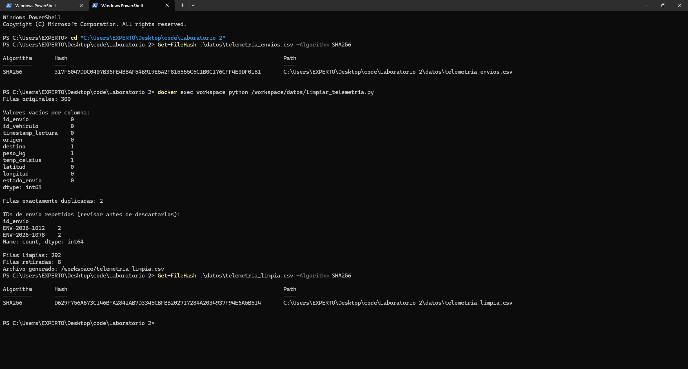
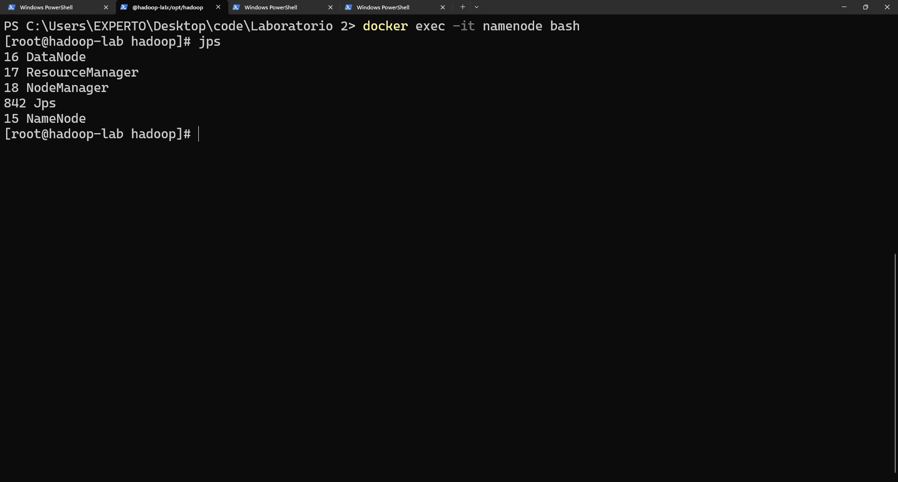
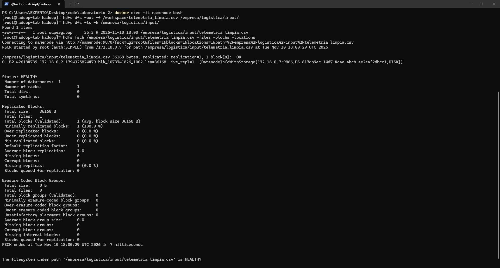
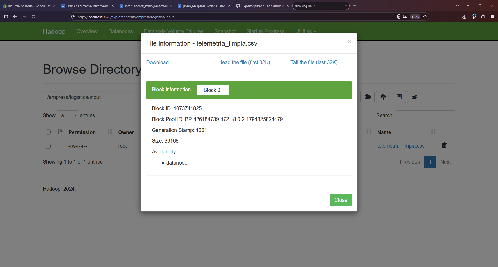

# Práctica Formativa Integradora: integridad del dato y HDFS

## 1. Integridad del dato — Módulo 5075

La comparación de integridad de esta práctica es entre los dos archivos locales: el CSV original, antes de depurarlo, y el CSV limpio, después del tratamiento. Como el contenido cambió durante la limpieza, es esperable que sus hashes sean distintos.

| Momento del tratamiento | Archivo | Filas de datos | SHA-256 obtenido |
|---|---|---:|---|
| Antes de depurar | `datos/telemetria_envios.csv` | 300 | `317F5047DDC0407B36FE4B8AF54B919E5A2F815555C5C1B0C176CFF4E0DF0181` |
| Después de depurar | `datos/telemetria_limpia.csv` | 292 | `D629F756A673C146BFA2842AB7D3345CBFBB202717284A2034937F94E6A5B514` |

**Comparación:** los hashes anterior y posterior son diferentes, lo que es coherente con la eliminación de registros durante la depuración.

La limpieza se realizó con **scripts/limpiar_telemetria.py**. El proceso informó 300 filas originales y 292 filas limpias (8 retiradas). Se quitaron filas exactamente duplicadas, registros con datos vacíos en campos clave, pesos negativos, la lectura anómala de 98.4 °C y el estado `DESCONOCIDO_ERROR`. El script también informa de IDs repetidos para revisión, sin descartar automáticamente registros solo por compartir ID.

Para repetir el cálculo de hashes en PowerShell desde la raíz del proyecto:

- **Get-FileHash .\datos\telemetria_envios.csv -Algorithm SHA256**
- **Get-FileHash .\datos\telemetria_limpia.csv -Algorithm SHA256**

Para repetir la limpieza con el archivo .py:

- **docker exec workspace python /scripts/limpiar_telemetria.py**

## 2. Despliegue y HDFS — Módulo 5074

El entorno se desplegó con Docker Compose en modo pseudodistribuido. El servicio Hadoop se ejecuta en el contenedor `namenode`; NameNode, DataNode, ResourceManager y NodeManager se inician juntos. La imagen incluye un JDK dentro del contenedor, por lo que no se requiere instalar Java en el equipo anfitrión.

### Puertos publicados por Compose:

| Puerto del anfitrión | Servicio |
|---:|---|
| `9870` | Interfaz web del NameNode |
| `8020` | RPC de HDFS |
| `9864` | Interfaz web del DataNode |
| `8088` | Interfaz web del ResourceManager de YARN |

Se crearon el directorio HDFS y se copió, listó y auditó el archivo con:

- **hdfs dfs -mkdir -p /empresa/logistica/input**
- **hdfs dfs -put -f /workspace/telemetria_limpia.csv /empresa/logistica/input/**
- **hdfs dfs -ls -h /empresa/logistica/input/**
- **hdfs fsck /empresa/logistica/input/telemetria_limpia.csv -files -blocks -locations**

`fsck` informó que el archivo ocupa un bloque y que el sistema de archivos está `HEALTHY`. El bloque observado fue `blk_1073741826_1002`, almacenado en el DataNode `172.18.0.7:9866`. La interfaz del NameNode se encuentra en *http://localhost:9870* y la del ResourceManager en *http://localhost:8088*.

## 3. Análisis crítico

En un clúster de producción, HDFS divide los archivos en bloques y guarda varias réplicas de cada bloque en distintos DataNodes, normalmente procurando distribuirlas entre racks. Si un DataNode se apaga, el NameNode detecta que deja de responder mediante los heartbeats y marca sus réplicas como no disponibles. Mientras quede otra réplica válida, los clientes pueden leer el bloque desde otro nodo; por eso la caída de un DataNode no implica necesariamente la pérdida del archivo *[1]*.

HDFS también verifica la integridad de los datos mediante checksums y puede detectar bloques dañados *[3]*. Si una réplica falla o queda por debajo del nivel configurado, el NameNode puede ordenar la replicación de bloques válidos hacia otros DataNodes *[1]*. El NameNode conserva los metadatos que relacionan archivos, bloques y ubicaciones; para proteger también la disponibilidad de esos metadatos, HDFS ofrece configuraciones de alta disponibilidad con NameNodes Active/Standby y failover *[2]*.

Este ejercicio usa un único DataNode y el factor de replicación es `1`, como muestra `fsck`. Por tanto, permite observar bloques y su ubicación, pero no demuestra tolerancia a la pérdida de un DataNode: si ese único nodo desapareciera, no habría otra réplica de los bloques. La redundancia descrita corresponde a un clúster de producción con varios nodos y un factor de replicación mayor que uno *[1]*.

## 4. Evidencias gráficas

Las capturas de la práctica se guardan en [`evidencias/`](evidencias/):

### 01 — Hashes SHA-256

### 02 — Procesos Hadoop con `jps`

### 03 — Comandos HDFS y auditoría de bloques

### 04 — Navegación en la interfaz del NameNode

#### Referencias Bibliográficas

[1] Apache Software Foundation, "HDFS Architecture," Apache Hadoop 3.4.0 Documentation. [En línea]. Disponible en: https://hadoop.apache.org/docs/r3.4.0/hadoop-project-dist/hadoop-hdfs/HdfsDesign.html. [Accedido: 10-nov-2026].

[2] Apache Software Foundation, "HDFS High Availability Using the Quorum Journal Manager," Apache Hadoop 3.4.0 Documentation. [En línea]. Disponible en: https://hadoop.apache.org/docs/r3.4.0/hadoop-project-dist/hadoop-hdfs/HDFSHighAvailabilityWithQJM.html. [Accedido: 10-nov-2026].

[3] Apache Software Foundation, "HDFS Users Guide," Apache Hadoop 3.4.0 Documentation. [En línea]. Disponible en: https://hadoop.apache.org/docs/r3.4.0/hadoop-project-dist/hadoop-hdfs/HdfsUserGuide.html. [Accedido: 10-nov-2026].
